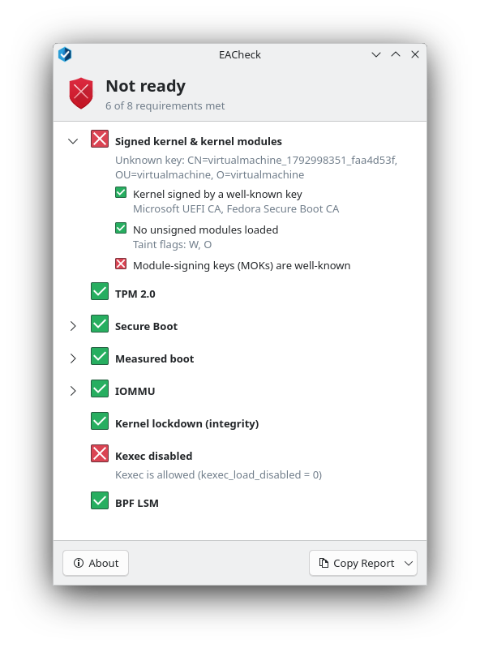

# EACheck

EACheck checks whether a Linux machine meets the
[Easy Anti-Cheat Linux v2 requirements](https://onlineservices.epicgames.com/news/introducing-easy-anti-cheat-linux-v2)
and shows which ones pass. It only reads system state, and asks for an admin password only to read
the TPM event log.



## Install

Download the Flatpak bundle or the AppImage from the
[latest release](https://github.com/Mahir007/EacReadyChecker/releases/latest). The window needs a
Wayland session. The command-line reports work without one.

Flatpak:

```sh
flatpak install --user eac-ready-checker-*-x86_64.flatpak
flatpak run io.github.Mahir007.EacReadyChecker
```

The bundle needs the KDE runtime from Flathub, and flatpak offers to add Flathub if it isn't set
up. The sandbox hides most of what the checks read, such as `/sys/firmware`, so the Flatpak has
permission to run commands on the host. The app uses it only to read files, and to run `pkexec` for
the event log.

AppImage, on distributions with glibc 2.34 or later (Ubuntu 22.04, Debian 12, Fedora 35, RHEL 9 and
later). It doesn't need libfuse2.

```sh
chmod +x eac-ready-checker-*-x86_64.AppImage
./eac-ready-checker-*-x86_64.AppImage
```

AppImageUpdate, Gear Lever and AppImageLauncher can update it from the latest release.

To build it from source, see [CONTRIBUTING.md](CONTRIBUTING.md).

## Usage

The window runs the checks when it opens. Parts of three of them need the TPM event log, which only
root can read: Signed kernel & kernel modules, Secure Boot and Measured boot. "Run Full Check" asks
for an admin password once and reads the log. Until then, those parts show "Needs admin".

| Verdict | Meaning |
| --- | --- |
| Ready for EAC Linux v2 | Every requirement passes or doesn't apply. |
| Not ready | At least one requirement fails. |
| Incomplete | Nothing fails, but at least one requirement needs admin access or couldn't be checked. |

"Copy Report" copies the results as text or as JSON. F5 runs the checks again.

Several checks look for well-known keys. Epic names the vendors whose keys are well-known, but
hasn't published the certificates. EACheck matches certificates by fingerprint against its own
list, collected from the vendors' signed shims and repositories.
[docs/well-known-keys.md](docs/well-known-keys.md) lists each certificate and where it came from.

| Requirement | Passes when |
| --- | --- |
| Signed kernel & kernel modules | The keys that verified the boot chain are well-known, no unsigned module has been loaded, and every enrolled Machine Owner Key (MOK) is well-known. |
| TPM 2.0 | The TPM is version 2.0. |
| Secure Boot | Secure Boot is on, the firmware isn't in setup mode, and only well-known keys were used to boot. |
| Measured boot | Replaying the TPM event log gives the TPM's PCR values, and the boot manager measured the kernel. |
| IOMMU | The IOMMU is on and passthrough is off. Machines whose firmware reports a handheld or tablet chassis don't need it. |
| Kernel lockdown (integrity) | Lockdown is in integrity mode. Confidentiality mode fails. |
| Kexec disabled | `kexec_load_disabled` is 1, or the kernel is built without kexec. |
| BPF LSM | BPF is one of the active LSMs. |

The results are what
EACheck can see on the machine. EAC does its own verification when a game starts.

## Command line

The Flatpak runs as `flatpak run io.github.Mahir007.EacReadyChecker`, the AppImage as the file
itself, and a build from source as `eac-ready-checker`. Each takes these options:

```
--text      print the report
--json      print the report as JSON, with the values each check read
--elevate   also run the checks that need admin access
```

The reports don't need a display. They exit with 0 for ready, 2 for not ready and 3 for
incomplete, and 1 is a usage error.

## Troubleshooting

### "No polkit authentication agent is running"

"Run Full Check" asks for the password through a polkit authentication agent. Plasma, GNOME and
most other desktops start one. Standalone compositors such as Sway and Hyprland don't, so start one
yourself, for example `hyprpolkitagent`, `lxqt-policykit` or `polkit-gnome`.

### A result looks wrong

Open an issue with the output of `--json --elevate`. It includes the kernel command line and the
subjects of the enrolled keys, which can name the machine, so look it over first. An unrecognised
key from one of Epic's vendors usually means EACheck's list is missing that certificate.

## License

GPL-3.0-or-later. See [LICENSE](LICENSE). The title bar used on GNOME is built from
QAdwaitaDecorations in `third_party/qadwaitadecorations`, which is LGPL-2.1-or-later, see its
[LICENSE](third_party/qadwaitadecorations/LICENSE).
